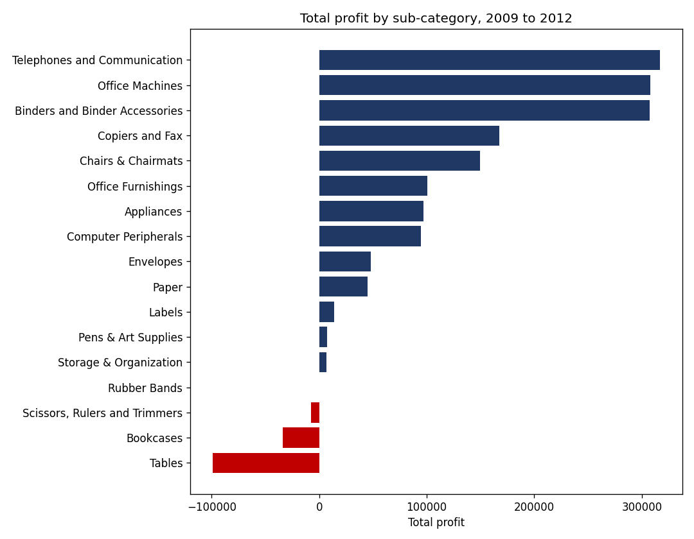
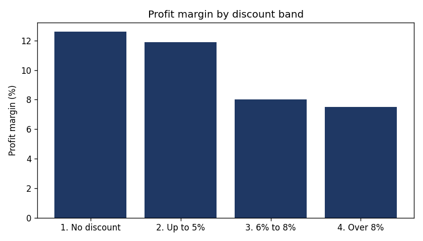

# Retail Sales Analysis: Where Does the Business Make and Lose Money?

**Tools:** SQL (SQLite) · Python (Pandas, Matplotlib) · Google Colab

## Business question
A retailer sold **$14.9 million** over four years but kept only **$1.52 million** as profit (a 10.2% margin). High sales don't always mean high profit. Which products, discounts and regions are draining profit, and what should the business change?

## Data
Superstore Sales sample dataset: **8,399 order lines**, **5,496 orders** and **795 customers** across 8 Canadian regions, January 2009 to December 2012. Columns include sales, profit, discount, product category, region, customer segment and shipping mode.

## What I did
- Loaded the CSV into a SQLite database and analysed it with SQL
- Cleaned the data: fixed a misspelled region ("Prarie" to "Prairie") that would have split one region into two, and checked for missing values
- Wrote queries using `GROUP BY`, `HAVING`, `CASE`, subqueries, a CTE and window functions (`RANK()` and `LAG()`)
- Built charts with Matplotlib to show the key findings

## Key findings

**1. Furniture sells but barely profits.**
Furniture brings in $5.18 million (35% of all sales) but makes only a **2.3% margin**, against 14.8% for Technology and 13.8% for Office Supplies.

**2. Tables and Bookcases lose money.**
Together they lost **$132,645** on $2.72 million of sales. Without these losses, total profit would be about **8.7% higher**.

**3. Bigger discounts cut margin.**
Margin falls from **12.6%** with no discount to **7.5%** when the discount is over 8%. Discounts above 5% cover 3,737 order lines and $6.49 million of sales.

**4. The biggest region is not the most profitable.**
West has the highest sales ($3.60 million) but only an 8.3% margin, so it ranks third for profit. Nunavut (2.4%) and Yukon (7.6%) have the weakest margins.

**5. Express Air was no faster.**
Delivery Truck, Express Air and Regular Air all averaged **2.0 days** from order to shipping.

## Recommendations
1. **Fix or cut loss-making furniture.** Review pricing, supplier costs and discounts on Tables and Bookcases, and consider dropping the worst-performing products.
2. **Limit discounts.** Set a 5% discount limit, with manager approval needed above it.
3. **Review weak-margin regions.** Investigate why West, Yukon and Nunavut earn lower margins, starting with discounts and shipping costs.
4. **Question Express Air spending.** It did not ship orders faster, so check whether its extra cost is worth paying.

## How to run
1. Open `retail_sales_analysis.ipynb` in Google Colab.
2. Upload `superstore_sales.csv` when the first cell asks for it.
3. Run each cell from top to bottom.
